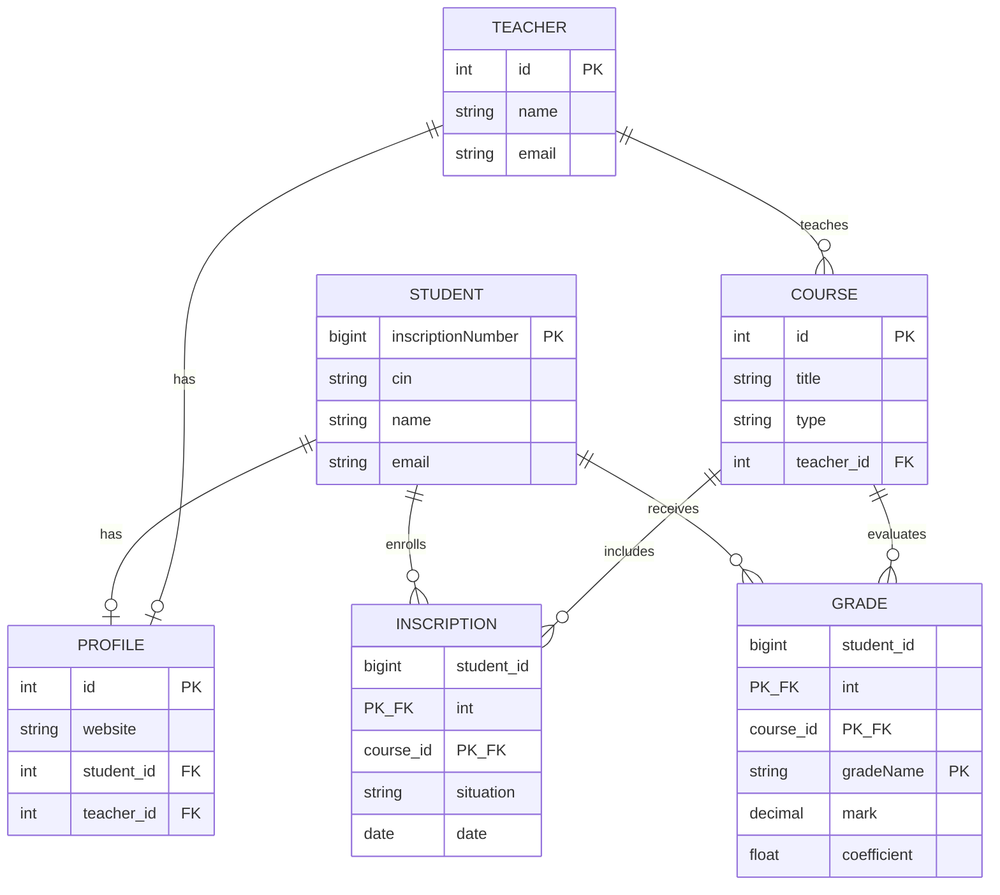

# University Management — Django Models Lab

[](https://www.python.org/)
[](https://www.djangoproject.com/)
[](#)

Teaching project for **ISG Tunis** (BI2 — Django models initiation).  
It models a small university domain with students, teachers, courses, inscriptions, grades, and profiles — focusing on **field types**, **relationships**, **`TextChoices`**, and **composite primary keys**.

---

## Domain overview



| Model | Role | Key idea |
|-------|------|----------|
| **Student** | Learner | Custom PK (`inscriptionNumber`), validators on CIN |
| **Teacher** | Instructor | Simple entity with unique email |
| **Course** | Teaching unit | `ForeignKey` → Teacher (`SET_NULL`), `CourseType` choices |
| **Inscription** | Enrollment | **Composite PK** `(student, course)` + status choices |
| **Grade** | Assessment mark | **Composite PK** `(student, course, gradeName)` |
| **Profile** | Public links | Two optional `OneToOneField`s (student / teacher) |

---

## Project structure

```text
django_model_initiation/
├── Pipfile / Pipfile.lock          # Pipenv dependencies
├── README.md
└── university_mgt_project/
    ├── manage.py
    ├── university_mgt_project/     # project settings & URLs
    └── student_app/
        ├── models.py               # domain models
        ├── enumerations.py         # TextChoices
        └── migrations/
```

---

## Requirements

- Python **3.14**
- [Pipenv](https://pipenv.pypa.io/)
- Django **6.x** and Pillow (for `ImageField`)

---

## Quick start

```bash
# 1. Clone
git clone https://github.com/ChaoukiBayoudhi/university_mgt_project.git
cd university_mgt_project

# 2. Install dependencies
pipenv install
pipenv shell

# 3. Apply migrations
cd university_mgt_project
python manage.py migrate

# 4. (Optional) Create a superuser for the admin
python manage.py createsuperuser

# 5. Run the development server
python manage.py runserver
```

Open [http://127.0.0.1:8000/admin/](http://127.0.0.1:8000/admin/) after creating a superuser.

---

## Models & enumerations

Choices live in `student_app/enumerations.py` using Django’s recommended **value + label** pattern:

```python
class CourseType(models.TextChoices):
    ONLINE = "online", "Online Course"
    ONSITE = "onsite", "On-site Course"
    HYBRID = "hybrid", "Hybrid Course"
```

Composite primary keys (Django 5.2+):

```python
# Inscription: one row per student–course pair
pk = models.CompositePrimaryKey("student", "course")

# Grade: one row per student–course–assessment type
pk = models.CompositePrimaryKey("student", "course", "gradeName")
```

> **Note:** `ForeignKey` cannot target a model that only has a composite PK. Keep separate FKs on `Grade` (`student`, `course`), or use `ForeignObject` / `clean()` for logical links to `Inscription`.

---

## Useful Django commands (lab)

### Migrations & SQL

```bash
python manage.py makemigrations
python manage.py migrate

# Print SQL for a migration without applying it
python manage.py sqlmigrate student_app 0001
```

### Inspect ORM SQL in the shell

```bash
python manage.py shell
```

```python
from student_app.models import Student
from django.db import connection, reset_queries

# SQL planned by the ORM (does not hit the DB)
qs = Student.objects.filter(name="Ali")
print(qs.query)

# SQL actually executed (needs DEBUG=True)
reset_queries()
list(qs)
print(connection.queries)
```

SQL logging can also be enabled in `settings.py` via the `django.db.backends` logger (already useful while `DEBUG = True`).

---

## Learning outcomes

After working through this project you should be able to:

1. Map a domain to Django models and table names (`Meta.db_table`)
2. Use common field types (`CharField`, `DateField`, `DecimalField`, `ImageField`, …)
3. Model **1–\***, **1–1**, and association entities
4. Define reusable **`TextChoices`** with stored value + display label
5. Use **`CompositePrimaryKey`** and understand its relation limits
6. Read the SQL generated by migrations and the ORM

---

## Tech stack

| Tool | Purpose |
|------|---------|
| Django 6.1 | ORM, migrations, admin |
| SQLite | Default local database (`db.sqlite3`) |
| Pipenv | Virtualenv + dependency lock |
| Pillow | Image uploads |

---

## License & context

Educational material for **ISG Tunis** — first semester Django / BI2 labs.  
Feel free to fork and adapt for classroom use.
